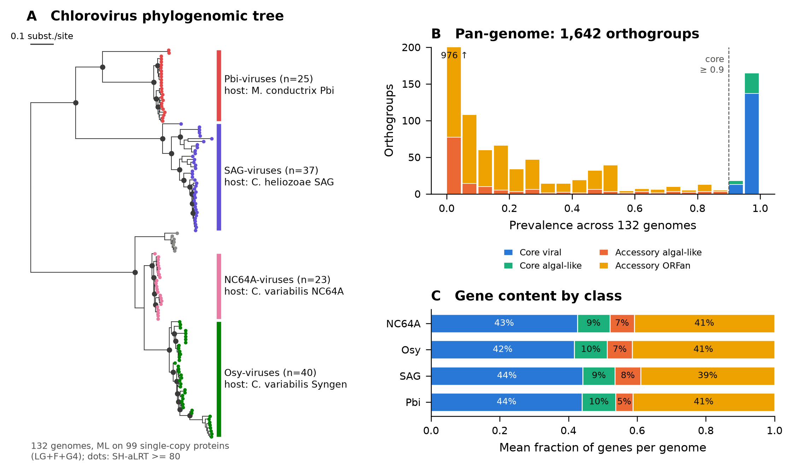
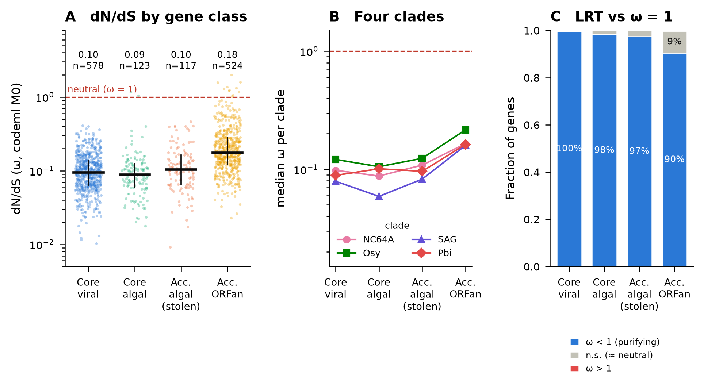
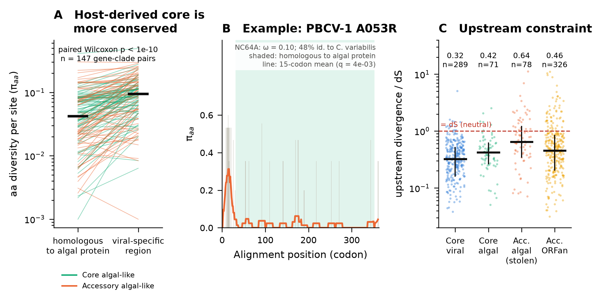

# Viral "gene package": do genes stolen from the host evolve neutrally in giant viruses?

*Microbial Omics (ITMO, 2026), phylogenomics mini-project. Author: Anna Chesnokova*

## Question

Giant DNA viruses (phylum *Nucleocytoviricota*, NCLDV) carry hundreds of genes, and many of them
were picked up from their hosts by horizontal gene transfer. A large part of this "gene package" has no
known function in the virus. After a gene is stolen, there are two possibilities:

* **H0 (neutral cargo).** The gene is not used. It drifts and decays, so its dN/dS is about 1 and the
  divergence of its promoter is about the same as at synonymous sites.
* **H1 (domesticated cargo).** The gene is used, so purifying selection acts on it (dN/dS < 1).
  If it is used, two more predictions follow:
  * the conserved positions should sit in the part of the protein that is homologous to the host protein
    (the inherited functional domain), not in the regions the virus added;
  * the upstream (promoter) region should be constrained, because the gene has been wired into the
    viral expression program.

## System

**Chloroviruses** (*Phycodnaviridae*, genome size ~290–410 kb) infect *Chlorella*-like green algae.
They are a good model for this question for three reasons:
1. many complete genomes are available (132 used here);
2. the host proteomes are sequenced (*Chlorella variabilis* NC64A, *Micractinium conductrix*, and
   relatives);
3. the viruses split into four clades by host range (NC64A-, Osy-, SAG- and Pbi-viruses). Each clade
   is an independent replicate of the analysis.

## Pipeline

```
NCBI (132 genomes, 4 algal proteomes)
  └─ 01 Prodigal: uniform gene calling (≥ 50 aa)                     → 50,063 proteins
  └─ MMseqs2 clustering (30 % id, 70 % cov)                           → 1,642 orthogroups (OGs)
  └─ 02 99 single-copy near-universal OGs → MAFFT → concatenation → IQ-TREE (LG+F+G4, SH-aLRT) species tree
  └─ 03 clades (largest monophyletic group around each reference virus)
        DIAMOND vs. green-algal proteomes (e ≤ 1e-5) + prevalence → 4 gene classes
  └─ 04 per clade × OG: codon alignment → IQ-TREE gene tree → codeml M0 (ω) + LRT against ω = 1
  └─ 05 per-site aa diversity; conservation heterogeneity (window permutation test);
        host-homologous vs. viral-specific region; upstream divergence / dS
  └─ 06 statistics + figures
```

Gene classes (per orthogroup):

| class | prevalence (132 genomes) | algal homolog in ≥ 50 % of members |
|---|---|---|
| Core viral | ≥ 0.9 | no |
| Core algal-like | ≥ 0.9 | yes |
| **Accessory algal-like ("stolen gene package")** | < 0.9 | **yes** |
| Accessory ORFan | < 0.9 | no |

## Main result: the stolen "gene package" is not neutral cargo



**Fig. 1.** (A) ML tree of 132 chlorovirus genomes (99 concatenated single-copy proteins, 22,004 aa
positions). It splits into four host-range clades, which are used as independent replicates.
(B) Prevalence of the 1,642 orthogroups across the 132 genomes, coloured by gene class.
(C) Gene content per genome by class: 7 % of genes (median 27 per genome) are accessory algal-like,
i.e. the stolen "gene package".



**Fig. 2. H0 is rejected: stolen genes are under purifying selection as strong as in core viral genes.**
(A) dN/dS per gene × clade (codeml M0; 1,342 estimates after the dS filter).
Median ω: core viral 0.095, core algal-like 0.089, **accessory algal-like 0.104**, accessory ORFans 0.177.
(B) The same ranking holds in each of the four clades. (C) Per-gene LRT against ω = 1 (BH q < 0.05):
ω < 1 is significant for **97.4 % (114/117) of stolen genes**. No stolen gene has ω > 1.

| test | result |
|---|---|
| stolen vs. ω = 1 (one-sample Wilcoxon on log ω) | p < 1e-10 |
| stolen vs. core viral, pooled OLS on log₁₀ω (+clade, dS, length; SE clustered by OG) | β = +0.039 [−0.04; 0.12], p = 0.34 (no difference) |
| ORFans vs. core viral, same model | β = +0.287 [0.24; 0.34], p < 1e-10 (ω about 1.9× higher) |
| stolen vs. ORFans, within each clade (MWU) | Cliff's δ = −0.27 … −0.58; q < 0.01 in 3 of 4 clades |
| ω vs. % identity to the *C. variabilis* homolog (recency of transfer) | Spearman ρ = −0.10, p = 0.36 |
| truncated copies (< 80 % of OG length) | stolen 0.3 % = core 0.3 % < ORFans 1.4 % (KW p = 5e-5) |



**Fig. 3. Where the conservation is.**
(A) Within algal-like genes, sites in the part homologous to the algal protein are about 3.5× less
variable than sites in the viral-specific extensions. For stolen genes: median π_aa 0.031 vs. 0.108,
paired Wilcoxon p = 1.2e-10, n = 69; the viral-specific part is more variable in 84 % of genes.
Stolen genes also have conserved blocks more often than core viral genes (51 % vs. 38 % with
significant window heterogeneity; χ² p = 0.03).
(B) Example: PBCV-1 A053R (48 % identity to *C. variabilis*). The protein is conserved along the
whole host-homologous region, and only the N-terminal viral extension is variable.
(C) Upstream intergenic regions diverge more slowly than synonymous sites in every class
(d_up/dS < 1, all p < 1e-3), so they are constrained. However, the promoters of stolen genes are
**less constrained** than those of core viral genes (median 0.64 vs. 0.32; MWU p = 7.6e-9,
Cliff's δ = 0.43).

### Interpretation

* Genes stolen from the algal host are **domesticated**. They do not decay neutrally: their proteins
  are under purifying selection as strong as in the essential viral core (median ω ≈ 0.1).
  This does not depend on how recently the gene was acquired (no correlation with identity to the
  host homolog).
* The constraint sits in the **inherited host domain**. The viral additions around it evolve about
  3–4× faster. This fits the idea that the virus keeps the host enzymatic function (examples in PBCV-1:
  chitinases, UDP-glucose dehydrogenase, GFAT, nucleotide-sugar epimerases, aspartate
  transcarbamylase; see `results/tables/stolen_genes_PBCV1_named.tsv`).
* The **regulatory wiring is looser** than the protein. Promoters of stolen genes are constrained,
  but about 2× less than those of core genes. The proteins are fully "packaged", while their
  expression control is still being integrated, or is shared with neighbouring genes.
* The truly unconstrained part of the genome is not the host-derived cargo. It is the **ORFans**,
  which have the highest ω, the most neutral-like genes and the most truncated copies.

All numbers are in [`results/stats.txt`](results/stats.txt).


## Reproduce

```bash
git clone <this repo> && cd ncldv-gene-package
conda env create -f environment.yml && conda activate ncldv-gene-package
bash run_all.sh            # downloads data from NCBI, then runs steps 01–06 (~2 h on 2 cores)
```

* The inputs are fixed by `data/accessions.txt` (132 GenBank accessions) and by the queries in
  `scripts/00_download.py`. `data/raw_checksums.md5` records the exact snapshot that was analysed
  (NCBI, 20 Oct 2026). Raw data are not stored in git (~90 MB).
* All random steps use fixed seeds (subsampling to ≤ 10 sequences per OG: seed 42; IQ-TREE: `-seed 42`).
* Tool versions used: Prodigal 2.6.3, MMseqs2 18.8cc5c, DIAMOND 2.2.8, MAFFT 7.526,
  IQ-TREE 3.1.4, PAML codeml 4.10.10, Biopython 1.88, SciPy 1.17.1, statsmodels 0.15.0, matplotlib 3.11.2, pandas 3.0.6.

### Repository layout

```
data/accessions.txt            genome accessions (input definition)
data/raw_checksums.md5         checksums of the analysed snapshot
scripts/00_download.py ... 06_stats_figures.py
results/figures/               Fig1–Fig3 (PDF, vector + PNG 300 dpi)
results/tables/                genome_clades, orthogroups_classified, dnds_per_gene, tests
results/stats.txt              every number quoted in the slides/README
slides/                        5-minute presentation (link + export)
```

## Limitations

* "Algal-like" means *homologous to a green-algal protein*. It does not prove the direction of transfer
  or that the donor was the current host. Some of these genes may have come from bacteria or from
  older eukaryotes.
* Orthogroups come from 30 %-identity clustering, so hidden paralogy is possible. Saturated
  comparisons are removed by the dS filter (median pairwise dS between 0.01 and 1.5).
* M0 gives one ω per gene. Site-level selection is approximated here by aa-diversity profiles,
  not by codeml site models.
* Promoter analysis uses ≤ 150 nt of intergenic sequence. Chlorovirus intergenic regions are short,
  so many genes cannot be tested.

## Archiving

The repository is meant to be pushed to GitHub and archived on Zenodo through the GitHub–Zenodo
integration (Zenodo → GitHub → enable the repository → create a release); this gives a DOI.
For a complete archive, upload the intermediate files (`work/`, ~150 MB) to the same Zenodo record.
